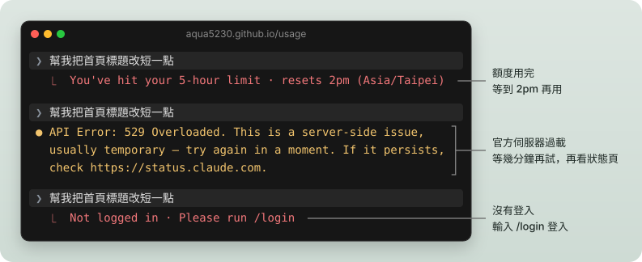
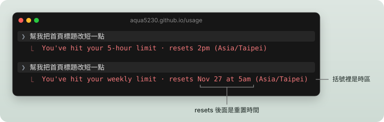
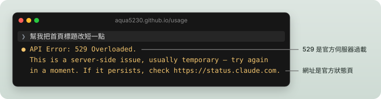
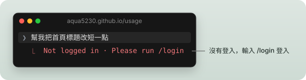

**Claude Code 或 Codex 突然停下來時，先看錯誤訊息裡有沒有「limit」和重置時間**。有，就是你的額度用完了，等到那個時間就會恢復。沒有，而是出現 `529`、`500`、`capacity` 這類字，就是官方伺服器出狀況，等幾分鐘再試，再去官方狀態頁確認。2026-11-26 查證。

- 作者在 2026-08-13 到 2026-11-26 之間，Claude Code 用完額度 37 次，碰上官方伺服器出狀況 9 次。Codex 用完額度 15 次，伺服器出狀況 7 次。
- 還有第三種情況：沒有登入，或連不上伺服器。這時訊息會叫你輸入 `/login`，或叫你檢查網路。
- 兩家都有官方狀態頁。Claude 看 `Claude Code` 和 `Claude API`，Codex 看 `Codex API`。



## 額度用完時，會看到什麼訊息？

Claude Code 用完額度時，會在你的提問下面用紅字顯示。上面是用完 5 小時額度，下面是用完每週額度：



`resets` 後面就是額度重置的時間，括號裡是時區。舊版 Claude Code 把 5 小時額度叫 `session limit`，寫成 `You've hit your session limit · resets 9:20pm`，意思一樣。

如果 Claude Code 正回答到一半時額度用完，它可能會先把目前這一步做完，這時你會看到 `Usage limit reached · wrapping up`。這句沒有寫重置時間，要到 claude.ai 或 Claude Desktop 的 **Settings > Usage** 查，做法見〈[Claude Code 每週額度什麼時候重置？](../claude-code-weekly-limit-reset/)〉。

Codex 用完額度時，會顯示：

```text
You’ve hit your usage limit. Upgrade to Pro (https://chatgpt.com/explore/pro), visit https://chatgpt.com/settings/usage to purchase more credits or try again at 5:07 AM.
```

最後的 `try again at` 就是可以再用的時間。

**這時候該做什麼**：等到訊息寫的時間。重開程式、重新登入都不會讓額度提早恢復。

## 官方故障時，會看到什麼訊息？

Claude Code 最常見的是 `529`，會用黃字顯示：



另一種是 `500`：

```text
API Error: 500 Internal server error. This is a server-side issue, usually temporary — try again in a moment. If it persists, check https://status.claude.com.
```

Anthropic 的官方錯誤說明是這樣寫的：`529` 代表 API 暫時過載，`500` 代表 Anthropic 內部系統發生了沒預料到的錯誤。兩種都是官方那邊的問題，跟你的額度無關。

Codex 遇到伺服器過載時，會顯示：

```text
Selected model is at capacity. Please try a different model.
```

或是：

```text
We’re currently experiencing high demand, which may cause temporary errors.
```

`at capacity` 的意思是你選的模型現在滿載了，訊息建議你換一個模型。

**這時候該做什麼**：Codex 叫你換模型時，可以換就照提示換；想用同一個模型，就等幾分鐘再送一次。一直失敗的話，就去官方狀態頁看是不是正在出狀況。

## 不是額度也不是故障，還可能是什麼？

還有兩種情況：沒有登入，或連不上伺服器。

Claude Code 沒有登入時，會顯示：



照它說的輸入 `/login`，重新登入就好。

Claude Code 連不上網路時，會顯示：

```text
API Error: Can't reach the API server — check your internet or DNS (ENOTFOUND)
```

回答到一半斷線時，會顯示下面這句，代表上面那段回答可能沒寫完：

```text
API Error: Connection lost mid-response. The response above may be incomplete.
```

Codex 斷線時，畫面上會出現 `Reconnecting to server…`，它會自己重新連線。

**這時候該做什麼**：沒登入就輸入 `/login`。連不上時，先打開別的網站，確認自己的網路正常；別的網站都正常，只有 Claude Code 或 Codex 連不上，再去看官方狀態頁。

## 實際上哪一種最常遇到？

作者掃了自己電腦上 Claude Code 和 Codex 的全部紀錄，時間從 2026-08-13 到 2026-11-26。同時開好幾個視窗、一起碰到同一次額度上限，只算一次。伺服器出狀況和網路斷線也一樣，前後相隔 10 分鐘內的算同一次。沒登入的情況沒有算進表裡。

| | 額度用完 | 官方伺服器出狀況 | 網路斷線 |
| --- | ---: | ---: | ---: |
| Claude Code | 37 次 | 9 次 | 3 次 |
| Codex | 15 次 | 7 次 | 0 次 |

Claude Code 的 37 次裡，32 次是 5 小時額度，5 次是每週額度。

所以作者遇到「突然不能用」的時候，大多數是自己的額度用完，不是官方故障。但官方出狀況也不算罕見，兩個工具加起來 16 次，平均一個月四次多。

## 官方狀態頁要看哪一項？

兩家都有公開的狀態頁，會列出每個服務現在正不正常：

- **Claude**：[status.claude.com](https://status.claude.com)。用 Claude Code 的話，看 `Claude Code` 和 `Claude API (api.anthropic.com)` 這兩項。
- **Codex**：[status.openai.com](https://status.openai.com)。用 Codex CLI（在終端機裡用的 Codex）的話，看 `Codex API`。

OpenAI 的狀態頁上還有 `Codex Web`、`Codex in ChatGPT Desktop` 這些項目。它們是網頁版和桌面版，就算顯示異常，Codex CLI 也可能照常能用。例如 2026-11-26 凌晨，`Codex Web` 顯示效能降級，但 `Codex API` 是正常的。

## 怎麼一眼看出是哪一種？

[`usage`](https://aqua5230.github.io/usage/zh-TW/) 是免費開源的 app，會把額度和官方服務狀態放在同一個地方，顯示在 macOS 選單列或 Windows 系統匣：

- **額度**：Claude Code 和 Codex 的 5 小時、每週額度，還有重置倒數。數字到 100% 時，你就知道是額度用完。
- **官方狀態**：每 5 分鐘檢查一次 Claude 和 Codex 的官方狀態頁。只看 `Claude Code`、`Claude API` 和 `Codex API`，不看網頁版、桌面版這些不影響 CLI 的項目。出狀況時，額度卡上會出現 `⚠ Claude 服務異常：部分中斷` 這類提示。

所以突然不能用時，先看錯誤訊息，再看一眼選單列確認：額度到 100%，就是額度用完；有服務異常的提示，官方多半正在出狀況。usage 每 5 分鐘才檢查一次，官方剛出狀況時，選單列可能還顯示正常，這時以錯誤訊息為準。

## 重點整理

- 訊息裡有 `limit` 和重置時間，是額度用完，等到那個時間。
- 出現 `529`、`500`，是官方伺服器出錯或過載；出現 `capacity`、`high demand`，是你用的模型或整個服務太忙。等幾分鐘再試，或照提示換模型，再看狀態頁。
- 叫你 `/login` 的，是沒有登入；叫你檢查網路的，先確認自己的網路，再看狀態頁。
- 作者三個多月的紀錄裡，Claude Code 額度用完 37 次、官方出狀況 9 次；Codex 額度用完 15 次、官方出狀況 7 次。

## 資料來源

- [Use Claude Code with your Pro, Max, or Ultra plan](https://support.claude.com/en/articles/11145838-use-claude-code-with-your-pro-max-or-ultra-plan)
- [Claude API errors](https://docs.anthropic.com/en/api/errors)
- [Claude 官方狀態頁](https://status.claude.com)
- [OpenAI 官方狀態頁](https://status.openai.com)
- [openai/codex 原始碼：錯誤訊息](https://github.com/openai/codex/blob/main/codex-rs/protocol/src/error.rs)
- [openai/codex 原始碼：重新連線](https://github.com/openai/codex/blob/main/codex-rs/tui/src/chatwidget/reconnect.rs)
