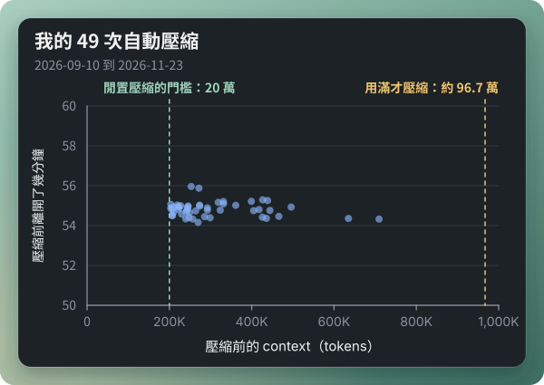
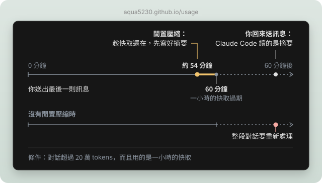

**Claude Code 有兩種自動壓縮：context 快滿時壓縮，以及你離開約一小時後壓縮**。後者叫閒置壓縮（idle compaction），2026 年 10 月才加入。我查了自己 9 月到 11 月的紀錄：49 次自動壓縮全部發生在我離開將近一小時之後，沒有一次是因為 context 滿了。

- 壓縮會把前面的對話換成一份摘要。CLAUDE.md 會重新載入，但只在對話裡交代過的事可能會不見。
- 閒置壓縮會在快取過期前先做好摘要。這樣你回來送下一則訊息時，Claude Code 不用把整段長對話重新處理一次。
- 想自己控制，可以用 `/compact` 指定要保留的重點，換任務時用 `/clear`。不想要閒置壓縮，可以在 `/config` 關掉。

## context 是什麼？

context（上下文）是 Claude 在這次對話裡看得到的全部內容。官方的定義是「一個 session 的工作記憶」，裡面有對話紀錄、讀過的檔案內容、指令的輸出、CLAUDE.md、自動記憶、載入的 skills 和系統指示。

打開 Claude Code 後，你還沒打字，context 裡就已經有 CLAUDE.md、自動記憶、MCP 工具的名稱和 skills 的說明。之後它每讀一個檔案、每跑一個指令，結果也會加進去。所以同一個對話用得越久，context 越大。

想看目前用了多少，在 Claude Code 裡打 `/context`。它會列出每一類各佔多少，並給出縮減的建議。

## 第一種：context 快滿時壓縮

context 有上限。Opus 4.7 以後、Sonnet 5 以後、Haiku 5.5 和 Fable 這些模型，上限是 100 萬 tokens（token 是模型計算文字的單位）。官方文件說，這些模型預設在約 96.7 萬 tokens 時自動壓縮。如果沒開延伸 context，Sonnet 4.6 和 Opus 4.6 會在 20 萬 tokens 時壓縮。

壓縮時，Claude Code 把對話整理成一份摘要，用摘要換掉原本的對話紀錄。所以即使 context 滿了，對話也不會中斷。

## 第二種：你離開約一小時後壓縮

這就是閒置壓縮。Claude Code 2.1.299 在 2026 年 10 月 14 日發布，更新紀錄寫著：

> Added idle compaction in the terminal: a 200K+ token conversation left idle for about 54 minutes is compacted before its one-hour prompt cache expires, so your next message doesn't reprocess it all

意思是：如果對話超過 20 萬 tokens，而且你離開了約 54 分鐘，Claude Code 會在一小時的快取過期前先壓縮。官方的設定說明列出五個條件，要全部成立：

- 你在終端機、VS Code 擴充套件的對話面板，或桌面版的 Code 分頁。
- 自動壓縮是開著的。
- 這個對話用的是一小時的快取。
- context 達到 20 萬 tokens。
- 距離上一次請求約一小時，而且電腦這段時間沒有進入睡眠。

壓縮完，終端機會出現一行以 `Compacted while idle, before the prompt cache expired` 開頭的文字。

## 我的紀錄：49 次自動壓縮，全部是閒置壓縮

Claude Code 會把每個對話存成 `~/.claude/projects/` 裡的一個 JSONL 檔。我用腳本讀這些檔案，找出每一次壓縮，再算壓縮前我離開了多久。

- 2026 年 9 月 10 日到 11 月 23 日，一共壓縮 50 次。1 次是我自己打 `/compact`，49 次是自動的。
- 49 次自動壓縮前，我都離開了 54～56 分鐘。每一次後面都有那行 `Compacted while idle` 通知。
- 壓縮前的 context 最小約 20 萬、最大約 71 萬 tokens。我用的 Opus 5.5 要到約 96.7 萬才會因為滿了而壓縮，這 49 次都還差得很遠。

所以，如果你常把對話開著去開會或吃飯，回來後看到的壓縮多半是閒置壓縮。

## 為什麼要趁你離開時壓縮？

因為快取只保存一段時間。快取（prompt cache）存的是已經處理過的對話內容。官方說明，沒有快取時，每一輪都要把整段歷史重新處理一次；有快取時，重讀的部分照快取的費率計算，只有新增的部分要完整處理。

快取的保存時間有兩種：5 分鐘和 1 小時。只有在你用訂閱方案、而且還在方案額度內時，Claude Code 才會為主對話使用一小時的快取。

一小時一過，快取就沒了。這時你回來送下一則訊息，幾十萬 tokens 的對話都要當成沒有快取的輸入重新處理。官方也說明，如果你離開的時間超過快取的保存時間，壓縮時也要重新處理整段歷史。因此回到舊對話時，`/compact` 的花費最高。閒置壓縮就是趁快取還在的時候，先把摘要做好。

照這些條件，還能推出一件事：額度用完、開始用加購額度（usage credits）付費之後，主對話的快取會改成 5 分鐘。這時「一小時的快取」這個條件不成立，閒置壓縮就不會發生。

## 壓縮後，什麼會留下、什麼會不見？

官方列了一張表，重點如下：

| 內容 | 壓縮後 |
|---|---|
| 專案根目錄的 CLAUDE.md、沒限定路徑的規則 | 從硬碟重新載入 |
| 自動記憶 | 從硬碟重新載入 |
| 計畫模式寫好的計畫 | 從硬碟重新載入 |
| 讀過或改過的檔案 | 重新讀最多 5 個，最近修改的優先；超過 5,000 tokens 的只留路徑 |
| 用過的 skills 內容 | 重新放回，每個最多 5,000 tokens，總共最多 25,000 tokens |
| 對話本身，包括 hook 加進來的內容 | 換成摘要 |

官方提醒，摘要會保留你的要求和關鍵程式碼，但對話早期交代的細節可能會不見。所以要一直遵守的規則，請寫進 CLAUDE.md，不要只在對話裡講。

## 怎麼自己控制壓縮？

- **自己先壓縮**：開始一個大任務前打 `/compact`，後面加上要保留什麼，例如 `/compact focus on the auth bug fix`。這樣摘要會保留你指定的重點。
- **換任務就清空**：要做不相關的事時打 `/clear`。官方說，舊對話會佔掉下一個任務需要的空間。而且之後每送一則訊息，舊對話都會算進 tokens 裡。
- **提早壓縮**：打 `/autocompact 500k`，context 到 50 萬 tokens 就會自動壓縮。
- **關掉閒置壓縮**：在終端機打 `/config`，改 **Idle compaction** 那一列。也可以在 `~/.claude/settings.json` 加上 `"idleCompaction": false`。
- **改閒置壓縮的門檻**：環境變數 `CLAUDE_CODE_IDLE_COMPACT_MIN_TOKENS` 可以把 20 萬改成別的數字，最低是 10 萬。

如果壓縮完 context 馬上又滿了，Claude Code 會停止自動壓縮，顯示 `Autocompact is thrashing: the context refilled to the limit...`。這通常是某個大檔案或很長的輸出造成的。官方建議請 Claude 分段讀檔、用 `/compact` 丟掉那段大輸出、把大檔案交給子代理處理，或直接 `/clear`。

## 怎麼隨時看到 context 用了多少？

- **`/context`**：Claude Code 內建的指令，列出每一類各佔多少。
- **usage**：`usage` 是免費開源的 app。它的終端機狀態列會顯示 context 用了幾 %。用到 70% 時，它會提醒你：要換任務就打 `/clear`，要接著做就打 `/compact` 留下重點。如果 context 增加得很快，提醒會提早到 55%～60% 出現。它也會把 Claude Code 的 5 小時和每週額度，顯示在 macOS 選單列或 Windows 系統匣。

## 資料怎麼來的

- 壓縮紀錄來自作者自己 Mac 上的 Claude Code 對話紀錄，期間是 2026-09-10 到 2026-11-23。壓縮是紀錄裡 `subtype` 為 `compact_boundary` 的那一行；同一次壓縮出現在好幾個檔案時，只算一次。離開多久，是從壓縮前最後一則訊息算到壓縮發生的時間。我先用自己的腳本算一次，再用另一個分析程式獨立算一次，兩次結果相同。
- 版本的發布日期來自 npm 上 `@anthropic-ai/claude-code` 的發布紀錄。
- 官方說明在 2026-11-25 對照過。

## 資料來源

- [Explore the context window](https://code.claude.com/docs/en/context-window)
- [How Claude Code works](https://code.claude.com/docs/en/how-claude-code-works)
- [Settings reference: idleCompaction](https://code.claude.com/docs/en/settings-reference#idlecompaction)
- [Model configuration](https://code.claude.com/docs/en/model-config)
- [How Claude Code uses prompt caching](https://code.claude.com/docs/en/prompt-caching)
- [Troubleshooting](https://code.claude.com/docs/en/troubleshooting)
- [Claude Code changelog](https://github.com/anthropics/claude-code/blob/main/CHANGELOG.md)
