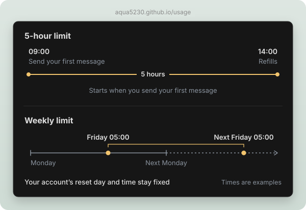

**Your Claude Code weekly limit resets once a week, on a fixed day and time that Anthropic assigns to your account.** It does not count from your last prompt. The day and time stay the same no matter when you started coding or when you subscribed, and each new week gives you the full allowance again. Checked on 2026-11-23.

- The weekly limit resets at the same day and time every week.
- Pro and Max plans also have a 5-hour limit. That clock starts when you send your first message, and the limit refills five hours later.
- Claude Code reports both limits, with their reset times, in the data it sends to your status line.

## How is the 5-hour limit different from the weekly limit?

Paid Claude plans have two limits. One is a session limit that resets every five hours. The other is a weekly limit that resets once a week. You use both of them up whenever you chat or run coding tasks.

The 5-hour limit starts when you send your first message, and it refills completely five hours later. If you run out before then, you have three choices: wait for the reset, turn on usage credits, or upgrade your plan.

The weekly limit works on a fixed schedule. Anthropic gives every account a weekly reset day and time, and that slot never moves. On Max and Ultra plans, Fable also has its own separate weekly limit.

## Does Claude Code share its limits with claude.ai and Claude Desktop?

Yes. Everything you do on claude.ai, Claude Desktop, the mobile apps, and Claude Code counts against the same limits. That includes Claude Code in your terminal and in IDEs such as VS Code, Cursor, IntelliJ, and PyCharm.

Claude Code tends to use up your limit faster than chat does. On every turn, Claude Code sends the whole conversation again, so a long session costs more per message. The model matters too: a turn on Opus costs several times more than a turn on Sonnet, and Sonnet costs more than Haiku. Anthropic suggests running `/clear` when you start a new task and `/compact` when you continue a long one. Content that you reuse inside Projects is cached, so it counts for less.

## How do the Pro and Max limits compare?

Pro, Max, and Ultra all let you use Claude and Claude Code with one subscription. Here is how their limits differ:

| Plan | Price per month | 5-hour limit | Weekly limit | Separate Fable limit | Wrap-up allowance |
| --- | --- | --- | --- | --- | --- |
| Pro | $20 | Refills 5 hours after your first message | Fixed weekly reset | No | Once per weekly period at most |
| Max | $100 | 5 times Pro | 5 times Pro | Yes | Each time you hit the 5-hour limit, while weekly usage remains |
| Verified Ultra | See the plan page | None | Fixed weekly reset | Yes | Does not apply |

If you upgrade after you hit a limit, the new plan's limits apply right away.

## What happens if you hit the limit in the middle of a task?

Suppose Claude Code is halfway through a response when you reach the 5-hour limit. Anthropic gives you a small wrap-up allowance, so Claude Code can finish the step it is working on. While it finishes, you see `"Usage limit reached · wrapping up"`. The allowance has a cap, it counts toward your weekly limit, and you cannot use it to start something new.

Anthropic also gives eligible plans a free limit reset from time to time. When you use one, your 5-hour or weekly limit refills right away, and your usual weekly reset time does not change. You cannot claim it from the terminal or the IDE. Open **Settings > Usage** on the web, in Claude Desktop, or in the mobile app instead.

## How can you check your weekly limit and reset time?

There are two free official ways, and a third option if you want the number on screen all the time:

- **Settings > Usage.** In claude.ai or Claude Desktop, this page shows progress bars for your current session and your weekly limits.
- **Claude Code's status line data.** Claude Code sends `rate_limits.five_hour` and `rate_limits.seven_day` to your status line. Each one has a usage percentage and a reset time.
- **The `usage` app.** `usage` is free and open source. It reads the same status line data and shows your 5-hour and weekly limits, with countdowns, in the macOS menu bar or the Windows system tray. If Claude Code isn't running, it can read the local usage history of a running Claude Desktop instead. A limit turns red as it gets close, and you can get a notification at 50%, 70%, 80%, 90%, or 95%. The default is 90%.

## Key takeaways

- The weekly limit resets at a fixed day and time assigned to your account. The 5-hour limit refills five hours after your first message.
- claude.ai, Claude Desktop, the mobile apps, and Claude Code all draw from the same limits.
- Claude Code reports `rate_limits.five_hour` and `rate_limits.seven_day` to your status line, and `usage` turns that data into a countdown in your menu bar or tray.

## Sources

- [How do usage and length limits work?](https://support.claude.com/en/articles/11647753-how-do-usage-and-length-limits-work)
- [Usage limit best practices](https://support.claude.com/en/articles/9797557-usage-limit-best-practices)
- [Use Claude Code with your Pro, Max, or Ultra plan](https://support.claude.com/en/articles/11145838-use-claude-code-with-your-pro-max-or-ultra-plan)
- [What is the Pro plan?](https://support.claude.com/en/articles/8325606-what-is-the-pro-plan)
- [What is the Max plan?](https://support.claude.com/en/articles/11049741-what-is-the-max-plan)
- [What is a limit reset?](https://support.claude.com/en/articles/17007452-what-is-a-limit-reset)
- [Models, usage, and limits in Claude Code](https://support.claude.com/en/articles/14552983-models-usage-and-limits-in-claude-code)
