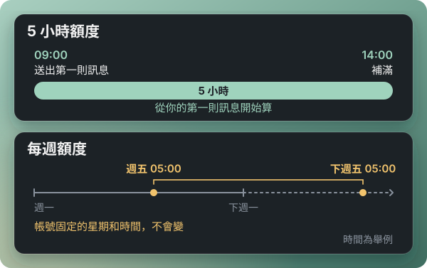

**Claude Code 的每週額度每週重置一次，時間是 Anthropic 指定給你帳號的固定星期和時刻**。它不是從你最後一次送出訊息往後算。不管你哪天開始寫程式、哪天訂閱，這個時間都不會變；每到這個時間，整週的額度就會補滿。2026-11-23 查證。

- 每週額度在每週同一個星期、同一個時間重置。
- Pro 和 Max 方案另外還有 5 小時額度。你送出第一則訊息時開始計時，5 小時後補滿。
- Claude Code 會把這兩種額度的用量和重置時間，一起交給狀態列。

## 5 小時額度和每週額度差在哪？

Claude 的付費方案有兩種額度。一種是每 5 小時重置的對話額度，另一種是每週重置一次的每週額度。你聊天或跑程式任務時，兩種額度會同時減少。

5 小時額度從你送出第一則訊息開始算，滿 5 小時後完整補滿。如果你提早用完，有三個選擇：等它重置、開啟額外用量（usage credits），或升級方案。

每週額度照固定時間表走。Anthropic 會給每個帳號一個固定的重置星期和時間，之後就不會再變。Max 和 Ultra 方案的 Fable 模型，另外還有一份獨立的每週額度。

## Claude Code 和網頁版、桌面版共用額度嗎？

共用。你在 claude.ai、Claude Desktop、手機 App 和 Claude Code 用掉的量，都算在同一份額度裡。Claude Code 不管是在終端機跑，還是在 VS Code、Cursor、IntelliJ、PyCharm 這些 IDE 裡跑，都一樣。

Claude Code 用掉額度的速度通常比聊天快。原因是 Claude Code 每一輪都會把整段對話重新送出去，所以對話越長，每則訊息就越貴。模型也有差：Opus 一輪的用量是 Sonnet 的好幾倍，Sonnet 又比 Haiku 多。Anthropic 建議換新任務時先跑 `/clear`，繼續長對話時用 [`/compact`](../claude-code-idle-compaction/)。放在 Projects 裡重複使用的內容會被快取，算的量也比較少。

## Pro 和 Max 的額度差多少？

Pro、Max 和 Ultra 都可以用同一個訂閱登入 Claude 和 Claude Code。三者的差別如下：

| 方案 | 月費 | 5 小時額度 | 每週額度 | Fable 獨立額度 | 收尾緩衝 |
| --- | --- | --- | --- | --- | --- |
| Pro | $20 | 第一則訊息後 5 小時補滿 | 固定時間每週重置 | 沒有 | 每週最多一次 |
| Max | $100 | Pro 的 5 倍 | Pro 的 5 倍 | 有 | 每週額度還夠時，每次用完 5 小時額度都能用 |
| 已驗證的 Ultra | 以方案頁為準 | 沒有 5 小時限制 | 固定時間每週重置 | 有 | 不適用 |

如果你用完額度後才升級，新方案的額度會立刻生效。

## 任務做到一半用完額度會怎樣？

假設 Claude Code 回答到一半，你剛好用完 5 小時額度。這時 Anthropic 會給一小段「收尾緩衝」（wrap-up allowance），讓 Claude Code 把手上這一步做完。收尾的時候，畫面會顯示 `"Usage limit reached · wrapping up"`。收尾緩衝有上限，用掉的量會算進每週額度，而且不能拿來開始新的工作。

Anthropic 也會不定期發「免費重置」（limit reset）給符合資格的方案。用了之後，5 小時或每週額度會馬上補滿，原本每週的重置時間不會改變。免費重置不能在終端機或 IDE 裡領，要到網頁版、Claude Desktop 或手機 App 的 **Settings > Usage** 領。

## 怎麼查每週額度還剩多少、什麼時候重置？

有兩種官方的免費查法。想讓數字一直顯示在畫面上，還有第三種做法：

- **Settings > Usage**：在 claude.ai 或 Claude Desktop 打開這一頁，會看到目前 5 小時額度和每週額度的進度條。
- **Claude Code 的狀態列資料**：Claude Code 會把 `rate_limits.five_hour` 和 `rate_limits.seven_day` 交給狀態列，裡面有已用百分比和重置時間。
- **usage**：`usage` 是免費開源的 app。它讀的是同一份狀態列資料，把 5 小時和每週額度連同倒數，顯示在 macOS 選單列或 Windows 系統匣。沒開 Claude Code 的時候，它也能讀正在執行的 Claude Desktop 留在電腦上的用量紀錄。額度快用完時數字會變紅；你也可以在用到 50%、70%、80%、90% 或 95% 時收到通知，預設是 90%。

## 重點整理

- 每週額度在帳號固定的星期和時間重置；5 小時額度在第一則訊息送出 5 小時後補滿。
- claude.ai、Claude Desktop、手機 App 和 Claude Code 共用同一份額度。
- Claude Code 會把 `rate_limits.five_hour` 和 `rate_limits.seven_day` 交給狀態列；`usage` 讀這份資料，在選單列或系統匣顯示倒數。

## 資料來源

- [How do usage and length limits work?](https://support.claude.com/en/articles/11647753-how-do-usage-and-length-limits-work)
- [Usage limit best practices](https://support.claude.com/en/articles/9797557-usage-limit-best-practices)
- [Use Claude Code with your Pro, Max, or Ultra plan](https://support.claude.com/en/articles/11145838-use-claude-code-with-your-pro-max-or-ultra-plan)
- [What is the Pro plan?](https://support.claude.com/en/articles/8325606-what-is-the-pro-plan)
- [What is the Max plan?](https://support.claude.com/en/articles/11049741-what-is-the-max-plan)
- [What is a limit reset?](https://support.claude.com/en/articles/17007452-what-is-a-limit-reset)
- [Models, usage, and limits in Claude Code](https://support.claude.com/en/articles/14552983-models-usage-and-limits-in-claude-code)
