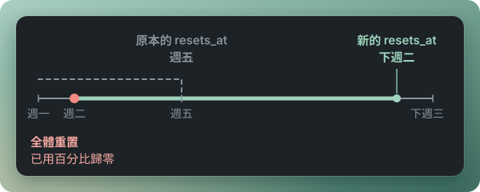

**OpenAI 對選定的帳號做「全體重置」時，你的 Codex 每週額度就會提早重置**。OpenAI 會把你的額度補回 100%，並且當場開始新的一週。你不會損失任何東西，所以提早重置等於提早拿回額度。Codex 顯示的 `resets_at`，代表額度「最晚」什麼時候會補滿。2026-11-23 查證。

- OpenAI 的 Codex 負責人 Tibo（X 帳號 `@thsottiaux`）會不定期幫選定的帳號重置用量，通常會先在 X 上預告。
- 作者自己的 ChatGPT Plus 帳號，在 2026-08-29 到 2026-10-07 之間經歷了 10 個週期，其中 9 個比 `resets_at` 提早結束：7 個碰上全體重置，2 個是作者自己用了儲備重置。只有 1 個撐到 `resets_at`。
- 重置之後，下一次補滿的日期會跟著改，新日期會取代舊日期。

## 為什麼 Codex 的每週額度還沒到時間就重置了？

ChatGPT Work 和 Codex 共用同一套價格、點數和額度。ChatGPT Plus 和 Business Standard 的 Codex 有 5 小時額度和每週額度；Pro 方案（`Pro 100`、`Pro 200`、`Pro 500`）目前只有每週額度，沒有 5 小時限制。

照理說，每週額度要到 `resets_at` 才會補滿。但 OpenAI 常常做一種官方說明裡叫「OpenAI 發放的自動重置」的動作，也叫全體重置（global reset）。OpenAI 會直接替選定的帳號套用，你不用自己領。Tibo 通常會在 X 上公告這類重置，他提過的理由有修好用量相關的問題、用戶數破紀錄、推出新模型等等。

全體重置不會出現在重置紀錄（History）裡。所以你實際看到的情況會是：已用的百分比突然變回 0，下一次補滿的日期也往後延。

## 提早重置有多常發生？

作者記錄了自己的 ChatGPT Plus 帳號，從 2026-08-29 到 2026-10-07。這段時間共有 10 個週期，只有 1 個撐到 `resets_at`：

- **7** 個週期碰上全體重置，**提早 1 到 6 天**結束，然後馬上開始新的週期。結束的時間都落在全體重置公告的當天。
- **2** 個週期是作者自己用了儲備重置，提早 2 到 3 天結束。
- 其中 **3** 個週期，作者已經把額度用到 **100%**。兩次靠儲備重置繼續工作，一次等到 `resets_at` 才補滿。

非官方網站 [codex-resets.com](https://codex-resets.com/) 會追蹤 `@thsottiaux` 的貼文，記下每一次重置。到 2026-11-23 為止，它記了 72 次，平均每 5.9 天一次，最長隔了 67.7 天。網站自己註明，資料是由 AI 分類的，不代表 OpenAI 的承諾。OpenAI 官方也說，免費重置屬於促銷活動，沒有固定時間表。

## 全體重置和「儲備重置」差在哪？

OpenAI 的說明頁把一次性的重置分成三種：

| 種類 | 怎麼拿到 | 補滿哪些額度 | 會出現在紀錄裡嗎？ |
| --- | --- | --- | --- |
| 全體重置（自動） | OpenAI 直接套用到選定的帳號 | 涵蓋的額度補回 100% | 不會 |
| 儲備重置（banked） | 先存在帳號裡，到期前自己使用。涵蓋的額度至少一項剩不到 80% 才能用；讓助手自動使用的話，要剩 10% 以下 | Go：每月額度。Plus、Business Standard：5 小時和每週額度。Pro 100、200、500：每週額度 | 會，保留 30 天 |
| 付費重置 | 部分 Plus 和 Pro 帳號可以購買 | 涵蓋的額度立刻補滿 | 不會 |

假設你先用了一次儲備重置，之後又遇到全體重置。全體重置只會把額度補回 100%，不會疊成 200%。還沒用掉的儲備重置會留在帳號裡。

## 既然會提早重置，resets_at 還有什麼意義？

你可以把 `resets_at` 當成額度「最晚」補滿的時間。如果中間沒有任何重置，這一週就會在這個時間結束。

如果提早重置了，時間表也會跟著改。OpenAI 舉過一個例子：某個週期原本週五結束，但週二被重置重新開始，那麼下一次補滿就是下週二，原本週五的時間不再適用。

## 怎麼查 Codex 還剩多少額度、多久重置？

有兩種官方的免費查法。想讓數字一直顯示在畫面上，還有第三種做法：

- **用量頁面**：網頁版打開 [usage dashboard](https://chatgpt.com/codex/settings/usage)，桌面版打開 **Settings > Usage & billing**。這裡會顯示剩多少額度、什麼時候補滿，以及 **Available** 底下還有幾次儲備重置。
- **Codex CLI**：輸入 `/status` 看剩多少額度。要使用儲備重置，輸入 `/usage` 再選 **Redeem reset**。
- **usage**：[`usage`](https://aqua5230.github.io/usage/zh-TW/) 是免費開源的 app。它讀你電腦上的 Codex 紀錄，把 5 小時和每週額度連同倒數，顯示在 macOS 選單列或 Windows 系統匣。額度快用完時數字會變紅；你也可以在用到 50%、70%、80%、90% 或 95% 時收到通知，預設是 90%。遇到全體重置時，你下次用 Codex 之後，選單列就會換成新的倒數，不用打開用量頁面。

## 重點整理

- Codex 每週額度提早重置，是因為 OpenAI 做了全體重置。你會拿回完整的額度，並開始新的一週。
- 作者自己的 Plus 帳號，2026-08-29 到 2026-10-07 的 10 個週期，有 7 個因為全體重置提早 1 到 6 天結束，2 個用了儲備重置，只有 1 個撐到 `resets_at`。
- `resets_at` 是額度最晚補滿的時間。想看目前的數字，可以用用量頁面、`/status`，或 `usage`。

## 資料來源

- [How resets work in Codex](https://help.openai.com/en/articles/20001498-how-resets-work-in-codex)
- [Pricing | ChatGPT Learn](https://learn.chatgpt.com/docs/pricing)
- [Understanding ChatGPT and Codex usage limits](https://help.openai.com/en/articles/20001625-understanding-chatgpt-and-codex-usage-limits)
- [Codex Limit Reset Tracker](https://codex-resets.com/)
