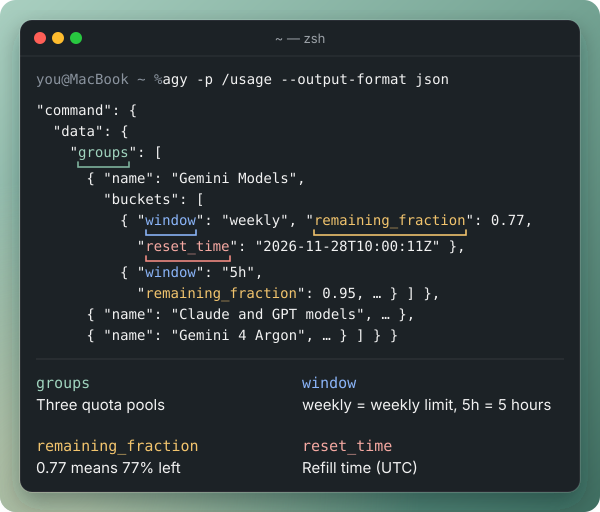

**To check your Antigravity (`agy`) quota, type `/usage` in the CLI, or run `agy -p /usage --output-format json` in your terminal.** The second command does not call a model, and it returns in about 6 seconds.

## How do you check your quota in the CLI or the app?

Google documents two built-in ways to see your baseline quota and your AI credits.

The first is the [CLI](../what-is-cli/). In an interactive session, type `/usage` (or `/quota`) and press Enter. Google's CLI docs say this refreshes your quota from the backend and opens a **Models & Quota** panel. You can scroll with the arrow keys or `J` and `K`, jump with `G` and `Shift + G`, and close the panel with `Esc` or `Q`. The right side of the status line also shows how many AI credits you have left, and it highlights the number when you are running low. To open a separate credits panel, type `/credits`.

The second is the app. Google's **Plans** page says you can see your baseline quota on the **Settings** page. If you are on Google AI Pro or Ultra, you can also set **AI Credit Overages** there. **Never** means you wait for your quota to refill. **Always** means Antigravity uses your AI credits once the quota runs out.

## How do you get your quota as JSON without calling a model?

If you want the numbers for a script or a status line, run the CLI in headless mode (`-p`) with JSON output:

```bash
agy -p /usage --output-format json
```

In our testing, this command makes no model call and returns in about 6 seconds. Google documents `/usage` as an interactive command, and it documents `agy -p` with `--output-format json`. It does not document using the two together, and it does not describe the `command.data.groups` field that holds the pools.



## Which models share quota?

The `command.data.groups` field lists two pools. Models in the same pool share a weekly limit and a 5-hour limit. Each pool resets on its own schedule. We verified the groups with Antigravity CLI 1.5.16 on 2026-11-24.

| Pool | Models | Shared limits |
| --- | --- | --- |
| `Gemini Models` | Gemini 4 Neon, Gemini 4 Carbon, Gemini 4 Argon, Gemini 4 Hydrogen, Orchestrator (Neon, Carbon, Argon), Gemini 3.8 Flash | Weekly and 5-hour |
| `Claude and GPT models` | Claude Opus 5.5, Claude Sonnet 5.5, GPT-OSS 120B | Weekly and 5-hour |

For example, if Neon uses up the Gemini pool's 5-hour quota, Argon hits that limit too. The Claude and GPT pool keeps whatever quota it had left.

## When do the 5-hour and weekly limits reset?

Google's **Plans** page says the refresh schedule depends on your Google AI plan:

- **Google AI Ultra:** the highest quota, refreshed every five hours, plus the highest weekly rate limit and access to third-party models.
- **Google AI Pro:** a high quota, refreshed every five hours until you reach the weekly limit, plus a higher weekly rate limit.
- **Other plans:** a baseline quota that refreshes weekly, plus a weekly rate limit.

Google also says that how fast you use quota depends on how much work the agent does. Simple tasks let you send more prompts, and complex tasks use more. The docs don't say when the 5-hour window starts. In our testing, it starts with your first use.

## How can you keep your Antigravity quota on screen?

There are two free official ways, and a third option if you want the number on screen all the time:

- **`/usage` or Settings.** Type `/usage` in `agy` to open the Models & Quota panel, or open the Settings page in the app.
- **`agy -p /usage --output-format json`.** Read both pools from `command.data.groups`.
- **The `usage` app.** [`usage`](https://aqua5230.github.io/usage/) is free and open source. It reads your quota with `agy -p /usage`. If that fails, it falls back to Google's quota endpoint, using the sign-in that the Antigravity CLI already saved. It shows your 5-hour and weekly limits, with countdowns, in the macOS menu bar or the Windows system tray. The Antigravity card shows the Gemini pool first. Tap the `Gemini ⇄` tag to switch between Gemini and Claude / GPT. The card remembers your choice. A limit turns red as it gets close, and you can get a notification at 50%, 70%, 80%, 90%, or 95%. The default is 90%.

## Key takeaways

- Type `/usage` in the Antigravity CLI to open the quota panel. Run `agy -p /usage --output-format json` to get the same data as JSON without calling a model.
- Gemini Models and Claude and GPT models each have a weekly and a 5-hour limit. Gemini 4 Argon shares both limits with the other Gemini models.
- `usage` shows the quota and countdown in your menu bar or tray, and one click switches between the two pools.

## Sources

- [Model quotas (/usage)](https://antigravity.google/docs/cli/commands/usage)
- [Plans](https://antigravity.google/docs/plans)
- [Headless mode](https://antigravity.google/docs/cli/headless)
- [CLI AI credits](https://antigravity.google/docs/cli/credits)
- [Choose a model](https://antigravity.google/docs/models)
