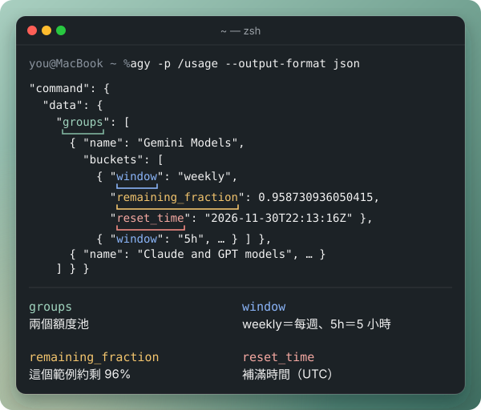

**想查 Antigravity（`agy`）剩多少額度，可以在 CLI 裡輸入 `/usage`，或在終端機執行 `agy -p /usage --output-format json`**。第二種方法不會呼叫模型，大約 6 秒就有結果。

## 怎麼在 CLI 或 app 裡查額度？

Google 的文件提供兩種內建查法，可以看基本額度和 AI 點數。

第一種在 CLI 裡。在互動模式輸入 `/usage`（或 `/quota`）再按 Enter。Google 的 CLI 文件說，這個指令會從伺服器重新抓額度，然後打開 **Models & Quota** 面板。你可以用方向鍵或 `J`、`K` 捲動，用 `G` 和 `Shift + G` 跳到最上面或最下面，按 `Esc` 或 `Q` 關掉面板。狀態列右邊也會顯示你還剩多少 AI 點數，快用完時會特別標出來。想看點數的詳細面板，就輸入 `/credits`。

第二種在 app 裡。Google 的 **Plans** 頁面說，你可以在 **Settings** 頁面看到基本額度。如果你訂的是 Google AI Pro 或 Ultra，還可以在這裡設定 **AI Credit Overages**：選 **Never**，額度用完就等它補滿；選 **Always**，額度用完後會改用你的 AI 點數。

## 怎麼不呼叫模型，直接拿到 JSON 格式的額度？

如果你想把數字拿去給腳本或狀態列用，可以用無頭模式（`-p`）加上 JSON 輸出來執行 CLI：

```bash
agy -p /usage --output-format json
```

我們實測，這個指令不會呼叫模型，大約 6 秒就有結果。Google 的文件分別介紹了互動式的 `/usage`，以及 `agy -p` 搭配 `--output-format json` 的用法，但沒有寫到兩者一起用，也沒有說明存放額度池的 `command.data.groups` 欄位。



## 哪些模型共用額度？

`command.data.groups` 欄位列出兩個額度池。同一池的模型共用每週和 5 小時額度。兩個額度池各自計時。我們在 2026-11-24 用 Antigravity CLI 1.5.16 確認了這份分組。

| 額度池 | 模型 | 共用額度 |
| --- | --- | --- |
| `Gemini Models` | Gemini 4 Neon、Gemini 4 Carbon、Gemini 4 Argon、Gemini 4 Hydrogen、Orchestrator（Neon、Carbon、Argon）、Gemini 3.8 Flash | 每週和 5 小時 |
| `Claude and GPT models` | Claude Opus 5.5、Claude Sonnet 5.5、GPT-OSS 120B | 每週和 5 小時 |

例如，如果你用 Neon 耗盡 Gemini 額度池的 5 小時額度，Argon 也會達到上限。Claude 和 GPT 模型仍可使用自己額度池的剩餘額度。

## 5 小時和每週額度什麼時候重置？

Google 的 **Plans** 頁面說，重置頻率要看你的 Google AI 方案：

- **Google AI Ultra**：額度最高，每 5 小時補滿一次，每週上限也最高，還能用第三方模型。
- **Google AI Pro**：額度高，每 5 小時補滿一次，直到用完每週上限；每週上限也比較高。
- **其他方案**：基本額度每週補滿一次，另有每週上限。

Google 也說，額度用掉的速度要看代理做了多少工作：簡單的任務可以多問幾次，複雜的任務用得比較快。文件沒有寫 5 小時額度從什麼時候開始算。我們實測，是從你當天第一次使用時開始。

## 怎麼讓 Antigravity 的額度一直顯示在畫面上？

有兩種官方的免費查法。想讓數字一直顯示在畫面上，還有第三種做法：

- **`/usage` 或 Settings**：在 `agy` 輸入 `/usage` 打開 Models & Quota 面板，或打開 app 的 Settings 頁面。
- **`agy -p /usage --output-format json`**。從 `command.data.groups` 讀取兩個額度池。
- **usage**。`usage` 是免費開源的 app。它用 `agy -p /usage` 讀額度；如果讀不到，就改用 Antigravity CLI 已經存好的登入資料，向 Google 的額度服務查詢。它會把 5 小時和每週額度連同倒數，顯示在 macOS 選單列或 Windows 系統匣。Antigravity 卡片預設顯示 Gemini 額度池。點一下 `Gemini ⇄` 標籤，可以在 Gemini 和 Claude / GPT 之間切換。卡片會記住你的選擇。額度快用完時數字會變紅；你也可以在用到 50%、70%、80%、90% 或 95% 時收到通知，預設是 90%。

## 重點整理

- 在 Antigravity CLI 輸入 `/usage` 可以打開額度面板；執行 `agy -p /usage --output-format json`，不用呼叫模型就能拿到一樣的資料。
- Gemini Models 和 Claude and GPT models 各有每週和 5 小時額度。Gemini 4 Argon 與其他 Gemini 模型共用這兩種額度。
- `usage` 會在選單列或系統匣顯示兩個額度池和重置倒數。

## 資料來源

- [Model quotas (/usage)](https://antigravity.google/docs/cli/commands/usage)
- [Plans](https://antigravity.google/docs/plans)
- [Headless mode](https://antigravity.google/docs/cli/headless)
- [CLI AI credits](https://antigravity.google/docs/cli/credits)
- [Choose a model](https://antigravity.google/docs/models)
