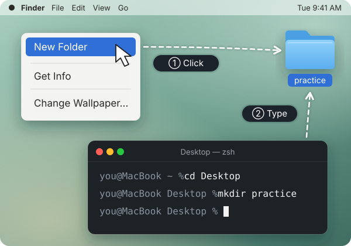
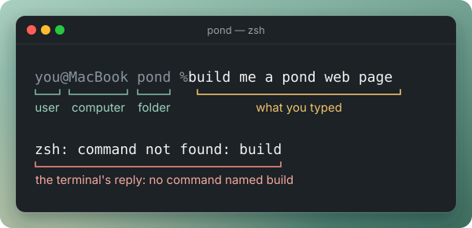
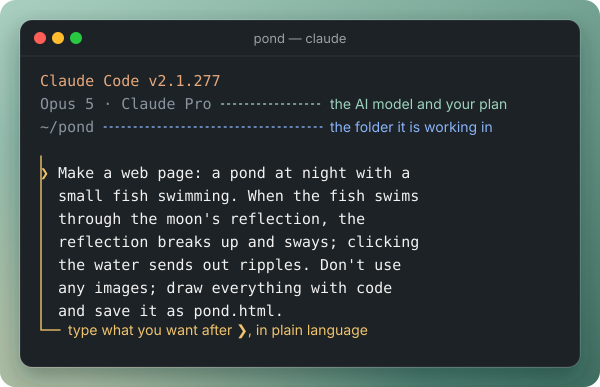
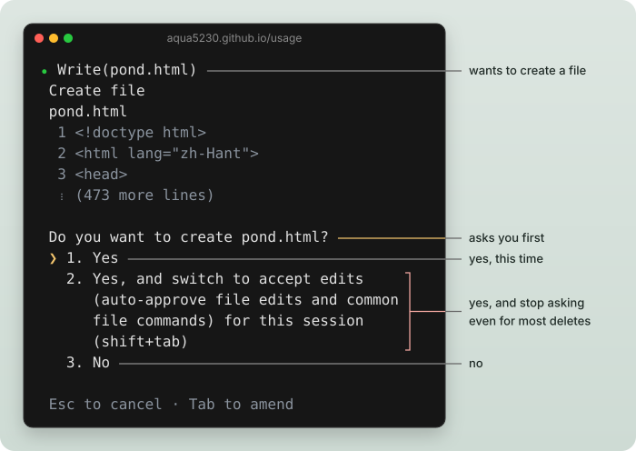
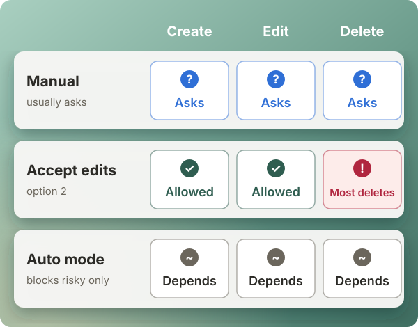
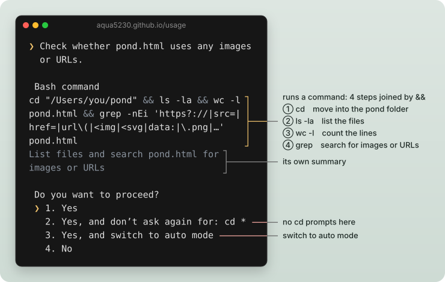

**A CLI (command-line interface) is a way to control a computer by typing commands.** You type a line in a terminal (the text window built into every Mac and Windows computer), press Enter, and the computer does it. The way you usually use a phone or laptop, by looking at icons and clicking buttons, is called a graphical user interface (GUI).

- Buttons only cover what engineers built in advance. Typing lets you ask for almost anything the computer can do.
- A terminal only understands specific commands. One wrong letter and it says it can't find the command, and deleted files skip the trash. That is why terminal users used to be mostly engineers.
- AI reads and writes text. A terminal takes text in and gives text back, so most AI assistants are built to work in it.
- Claude Code is an AI assistant that works inside the terminal. You describe what you want in plain language; it types the commands, writes the code, and saves the result straight into your folder.


The pond above is a web page. Try clicking the water. When the fish swims through the moon's reflection, the reflection breaks up and sways. The fish, the moon, and the lily pads are all drawn by code, and the page contains no image files. I didn't write any code. I typed one sentence in a terminal. The rest of this post uses that example to explain what a CLI is, how Claude Code works, and which line to read when it wants to touch your files.

## What did that one sentence look like?

I opened Claude Code in the Mac terminal and typed this:


Here's the English translation of what I typed.

```
Make a web page: a pond at night with a small fish swimming.
When the fish swims through the moon's reflection, the reflection
breaks up and sways; clicking the water sends out ripples. Don't use any
images; draw everything with code and save it as pond.html.
```

After pressing Enter, I didn't touch the keyboard again. 19 minutes later, a file called `pond.html` appeared in the folder, and opening it showed the pond. In those 19 minutes, Claude Code went through 28 rounds on its own: take a step, check the result, decide the next step. It ended up writing 476 lines of code.

Those three numbers are for the first version. Afterwards I asked it to turn the fish into a red-and-white koi and brighten the lily pads; the picture above shows that revised version. The model was Claude Opus 5, and at pay-as-you-go API prices the run would have cost about $5.16.

## How is a CLI different from a GUI?

On a phone or computer, the screens you see and tap or click make up the graphical user interface (GUI). The screen shows you what you can do. A terminal window is all text, with no options laid out for you. You tell the computer what to do by typing a line, and that is what a CLI is.

Both ways can do the same job. Take creating a folder called "practice":

- Using a GUI: right-click the desktop, choose New Folder, and name it "practice".
- Using a CLI: in the terminal, type `cd Desktop` and press Enter to move to the desktop, then type `mkdir practice` and press Enter. The folder is created wherever the terminal currently is.



Either way, you end up with a folder called "practice". When `mkdir` succeeds, it prints nothing; if a folder with that name already exists, it replies `File exists`.

If a GUI can do the job, why use a CLI? Think about two ways to order at a stir-fry restaurant. You can look at the menu and point to a dish, but you can only order what's listed. Regulars can skip the menu and tell the owner what they want. They can order anything the kitchen can make, as long as they know how to ask for it.

A GUI is like that menu. You can only click the buttons the engineers put there. A CLI is like talking to the owner. You can type a request for almost anything the computer can do, but you have to know how to ask.

## If typing is so flexible, why did so few people use it?

Because a terminal only understands specific words, called commands. It treats the first word you type, up to the first space, as the command name. Misspell the command name by one letter, or type a plain sentence, and it says the command doesn't exist:



The `zsh` at the start of the reply is the program in the Mac terminal that receives commands. It takes the first word, `build`, as the command name and can't find it. `mkdir practice` works because `mkdir` is the command and practice is just the folder name.

The command for deleting files is `rm`, and it doesn't ask before it acts. A photo you delete on your phone goes to Recently Deleted first and only disappears later. A file deleted with `rm` skips the trash and is gone immediately. You had to memorize commands and type them without mistakes, so the people who used terminals were mostly engineers.

## Can you use a terminal without memorizing commands?

Yes, with AI: let it type for you. Claude Code is an AI assistant made by Anthropic. It works in the terminal and understands plain language. You say what you want, and it decides which commands to run and what code to write.

Once Claude Code is installed (the steps are in "Try it yourself" at the end), type `claude` in the terminal and press Enter. The first time, it asks you to sign in; after that, you see a screen like this. At the terminal's own `%` prompt you type commands; at Claude Code's `❯` prompt you describe what you want in plain language:



The `~` before the folder name is your home folder, which holds Desktop, Documents, and Downloads.

You may have used the Claude or ChatGPT chat apps. Ask one for the same page and it can write the code too. The difference is where the result ends up:

- Chat app: if it only gives you code in the conversation, you copy it and save it as a file yourself, and every revision means copying and saving again.
- Claude Code: it saves the file straight into a folder on your computer. When you want a change, it edits that file directly.

So Claude Code can reach the files on your computer: it can read them, write them, and delete them. That is what makes it useful, and it is also what you need to watch.

## Why are AI assistants built to work in the terminal?

A terminal takes text in and gives text back. That's what AI is good at.

People use a GUI by looking for a button, moving to it, and clicking. AI reads and writes text. In a terminal, it types a command and the computer prints the result as text. The AI reads the result and decides what to type next. That's how it built the pond, one round at a time for 28 rounds.

AI can use a GUI too. It takes a screenshot, finds the button, then moves to it and clicks. It has to look at the screen again at every step. If a button moves, a pop-up gets in the way, or the app changes its layout, the AI might click the wrong thing. Commands work independently of what's on the screen.

That's why more apps offer their own CLI so AI can use them by typing commands. One example is Feishu's `lark-cli`. Once it's installed, AI can use commands to read and write Feishu documents, calendars, and messages.

## How does AI learn to use a new CLI?

Every CLI has its own command names, and AI may never have seen them. It can type `--help`, a help option most CLIs have, to look up how to use it. Starting from scratch each time can take several extra rounds.

Another way is to give it a skill, a set of instructions written for AI. The first sentence or two says when to use it. The rest lists the commands and explains how to use them. Claude Code usually reads just the first sentence or two of each skill. When a task calls for one, it reads the whole thing.

The Feishu CLI comes with 28 skills. Approvals, calendars, documents, and messages each have one. The opening of the document skill says, roughly, that it can read, create, and edit Feishu documents and that you use it when the user gives you a document URL.

While writing this post, I asked Claude Code to use the Feishu CLI to read WaytoAGI, a public Chinese-language AI knowledge base hosted on Feishu. The home page linked to 72 pages. Claude Code ran `lark-cli docs +fetch` once for each page, got 66 pages back, and looked through them for articles about CLIs. It never opened a browser.

## Does Claude Code ask before it touches your files?

It can. Claude Code has a permission mode called Manual. In this mode, it stops and asks you before it creates a file, edits a file, or runs most commands. Simply reading files in the folder usually doesn't prompt.

If it wants to create `pond.html`, you see a screen like the one below. I captured it when I asked it to create a test file, then replaced the file name and contents with `pond.html`:



The one thing to understand is what it is about to do. Be careful with option 2: once you choose it, it won't ask again even before ordinary file deletions in this folder.

When it built the pond, it never asked me anything. I ran it without the interactive screen (`claude -p`, which hands over the whole task in one command), and I had allowed only file writes before starting. I was comfortable doing that because it was a brand-new, empty folder with nothing to break. In any normal folder, I read every prompt.



One more thing to know: since Claude Code 2.1.283, a session started in the terminal begins in auto mode, as long as your model supports it and your organization's admin hasn't turned it off. In auto mode, a second AI model reviews actions instead of you. Actions that look safe go ahead, and actions that look risky are blocked first. If you want it to ask before every change or command, use `--permission-mode manual`, shown in "Try it yourself" below.

## When it says it's done, is it really done?

When the pond was finished, Claude Code told me: "I've written pond.html, but I haven't run it. This environment doesn't allow opening a browser or running scripts, so I only checked it line by line." It wrote 476 lines without ever seeing the result, because I had only allowed it to save files, not to open a browser or run programs.

So I checked twice myself. First, I opened the file: the fish was swimming, and clicking the water made ripples. Second, I asked it in plain language whether the page used any images. It needed to run a command, so it stopped to ask me first:



All four steps only look and search; none of them edits or deletes anything, so I pressed 1. If you can't tell what a step does, choose No to decline, ask it to explain the command piece by piece, and then decide.

Newer versions of Claude Code run read-only commands like these without asking, so this prompt no longer appears.

It replied: "No. pond.html doesn't use any image files or URLs." The search found no image files or URLs.

## Try it yourself

**Open a terminal.** This is free and won't change anything on your computer.

- Mac: hold ⌘ Command and press Space, type "Terminal", and press Enter. When the window opens, type `cal` and press Enter. It prints this month's calendar.
- Windows: open Start, search for "PowerShell" (the Windows terminal), and open it. Type `Get-Date` and press Enter. It shows the current date and time.

**Install Claude Code.** Installing doesn't require an account, but signing in to use it requires a paid Claude plan (Pro or higher) or an Anthropic Console account; the free plan doesn't include Claude Code. Your computer needs macOS 13 or later, or Windows 10 (version 1809) or later. Install commands put software on your computer, so only paste the line from the [official setup page](https://code.claude.com/docs/en/setup).

Mac:

```
curl -fsSL https://claude.ai/install.sh | bash
```

Windows (PowerShell):

```
irm https://claude.ai/install.ps1 | iex
```

After installing, close the terminal window and open a new one. Otherwise, typing `claude` may say the command isn't found.

**Open Claude Code in an empty folder.** If an empty folder gets messy, nothing is lost. Press Enter after each line:

```
mkdir first-try
cd first-try
pwd
claude --permission-mode manual
```

The first line creates a folder called "first-try", and the second moves into it. The third line, `pwd`, prints the folder you're in. Check that it ends in "first-try" before going on. This matters because Claude Code works in the folder where you start it. The fourth line starts Claude Code set to ask you before any change or command. If the first line says `File exists`, a folder with that name is already there. Pick another name and type all four lines again. The first time, it opens a browser so you can log in, and asks whether you trust this folder. It's the empty folder you just made, so choose to trust it. Type `/exit` to leave.

**Start with something small.** Replace March 14 with your own birthday and type:

```
Make a web page that counts down to my birthday (March 14) and save it as birthday.html.
```

If it's going in the wrong direction, press Esc to stop it. The work it's already done stays in place. Tell it in plain language what to change.

When it says it's done, ask it to open the page. It will ask before running the command that opens the file; if you can see it's only opening the file, choose Yes. Then check the countdown yourself. I tried this sentence on October 2, 2026. When it finished, it said it "couldn't verify the date logic", so I counted the days myself. It was correct.

If you don't like how it looks, tell it what to change, for example:

```
Make the background dark blue and the numbers twice as big.
```

When it's done, ask it to open the page again and see if it looks the way you want.

## Sources

- [Set up Claude Code](https://code.claude.com/docs/en/setup)
- [Choose a permission mode](https://code.claude.com/docs/en/permission-modes)
- [Extend Claude with skills](https://code.claude.com/docs/en/skills)
- [Interactive mode](https://code.claude.com/docs/en/interactive-mode)
