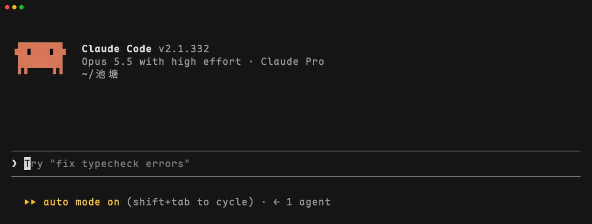
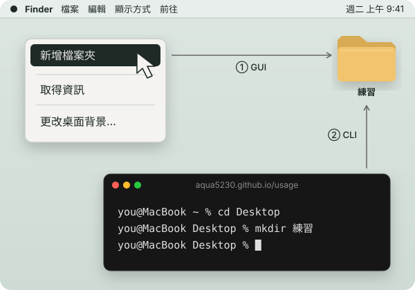
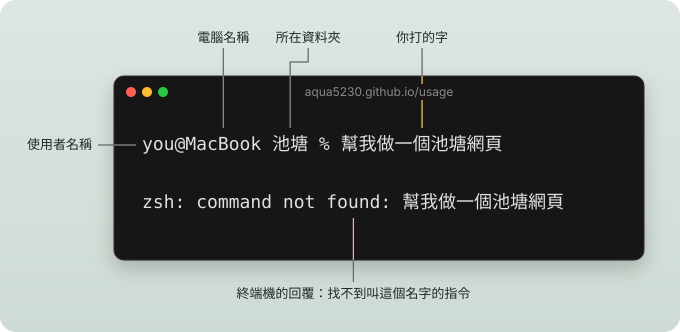
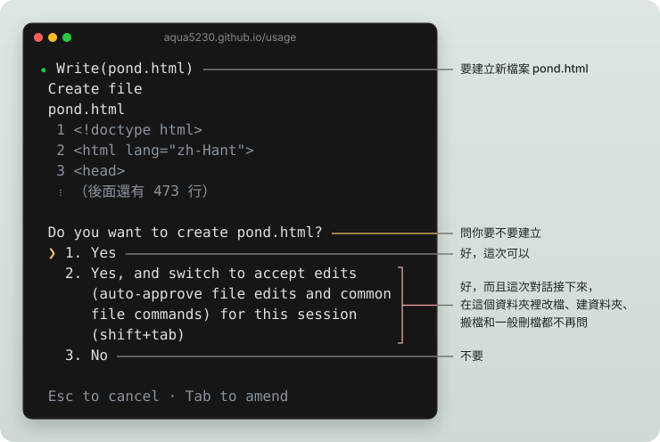

**CLI（command-line interface，命令列介面）是用打字下命令來操作電腦的方式**。你在終端機（Terminal，Mac 和 Windows 都內建的打字視窗）打一行字、按 Enter，電腦就照著做。平常用手機和電腦時，看圖示、點按鈕的那一種叫圖形介面（GUI）。

- 按鈕只有工程師事先做好的那幾顆；打字可以交代電腦做得到的幾乎任何事。
- 終端機只認特定的指令。打錯一個字母，它就說找不到指令；刪掉的檔案也不會進垃圾桶，所以以前會用的多半是工程師。
- AI 讀的、寫的都是文字，終端機剛好是打字進去、文字出來，所以 AI 助手大多做在終端機裡。
- Claude Code 是在終端機裡工作的 AI 助手。你用中文說要什麼，它替你打指令、寫程式，做好的檔案直接存進你的資料夾。


上面這座池塘是一個網頁，點一下水面試試。魚游過月亮時，倒影也會晃開。魚、月亮和睡蓮葉都是程式畫的，裡面沒有一張圖片。我沒寫程式，只在終端機裡打了一句話。下面用這個例子說明 CLI 是什麼、Claude Code 怎麼用，還有它要動你的檔案時，你要看懂哪一行。

## 那一句話長什麼樣？

我在 Mac 的終端機裡打開 Claude Code，打了這一句：



按下 Enter 之後，我就沒再碰鍵盤。19 分鐘後，資料夾裡多了一個叫 `pond.html` 的檔案，點開就是池塘。這 19 分鐘裡，Claude Code 自己來回跑了 28 輪：做一步，看一眼結果，再決定下一步。最後它寫了 476 行程式。

這三個數字都是第一版的。後來我請它把魚改成紅白錦鯉、把睡蓮葉調亮，上面那張圖是改好的樣子。這次用的模型是 Claude Opus 5，照 API 按用量付費的價格換算，約 5.16 美元。

## CLI 和 GUI 差在哪？

手機和電腦上，眼睛看得到、用手指或滑鼠點的畫面，叫圖形介面（GUI，graphical user interface）。能做什麼，畫面上都擺給你看。終端機不一樣，視窗裡全是字，看不到任何選項。你要電腦做什麼，就自己打一行字，這種用法就是 CLI。

同一件事，兩種方式都做得到。例如建一個叫「練習」的資料夾：

- 用 GUI：在桌面按右鍵，選「新增檔案夾」，再打上「練習」。
- 用 CLI：在終端機先打 `cd Desktop`，按 Enter，切到桌面；再打 `mkdir 練習`，按 Enter。資料夾會建在終端機目前所在的位置。



兩邊做完，都會多一個「練習」資料夾。`mkdir` 成功時什麼都不會印出來；如果同名的資料夾已經存在，它會回 `File exists`。

既然 GUI 就做得到，為什麼還要用 CLI？想想在熱炒店點菜的兩種方式。看菜單點，每道菜都印在上面，指一下就好，但只能點菜單上有的。熟客不看菜單，直接跟老闆說要什麼，廚房做得出來的都能點；前提是你自己說得出菜名。

GUI 就是那張菜單：工程師事先做了哪幾顆按鈕，你就只能按那幾顆。CLI 就是直接跟老闆說：電腦做得到的事，幾乎都能用打字交代，但你要知道怎麼說。

## 打字這麼自由，為什麼以前很少人用？

因為終端機只認特定的字，這些字叫指令（command）。它會把你打的第一段字（到第一個空格為止）當成指令名稱。指令名稱拼錯一個字母，或直接打一句中文，它都會說找不到這個指令：



回覆開頭的 zsh，是 Mac 終端機裡負責接收指令的程式。整句中文中間沒有空格，所以它把整句當成指令名稱，結果找不到。前面的 `mkdir 練習` 能用，是因為指令名稱是 `mkdir`，「練習」只是資料夾的名字。

刪除檔案的指令是 `rm`，它也不會先跟你確認。手機刪掉的照片會先放進「最近刪除」，過一陣子才真的消失；用 `rm` 刪掉的檔案不經過垃圾桶，直接就沒了。指令要背，打字還不能出錯，所以以前會用終端機的，多半是工程師。

## 不會背指令，怎麼用終端機？

有了 AI 之後，多了一個辦法：讓 AI 替你打。Claude Code 是 Anthropic 做的 AI 助手，在終端機裡工作，聽得懂中文。你說想要什麼，它會自己決定要打哪些指令、寫哪些程式。

裝好 Claude Code 之後（安裝步驟在文末「自己試一次」），在終端機打 `claude` 再按 Enter。第一次會先請你登入，登入後會看到類似這樣的畫面。終端機原本的 `%` 後面要打指令；進到 Claude Code 之後，`❯` 後面打的是你想做的事，用中文就可以：


資料夾前面的 `~` 代表你的個人資料夾，桌面、文件、下載都在裡面。

你可能用過 Claude 或 ChatGPT 的聊天 App。在那裡說同一句話，它也寫得出池塘。差別在於做好之後，東西放在哪裡：

- 聊天 App：如果它只在對話裡給你一段程式碼，你就要自己複製、自己存成檔案；想改一點，改好的版本也要再複製、再存一次。
- Claude Code：它直接把檔案存進你電腦的資料夾。要改的時候，它直接改那個檔案。

所以 Claude Code 碰得到你電腦裡的檔案：讀得到、寫得進，也刪得掉。這是它好用的原因，也是你要注意的地方。

## AI 助手為什麼都做在終端機裡？

因為終端機是打字進去、文字出來，這剛好是 AI 擅長的事。

人用 GUI 靠眼睛：看到按鈕在哪，移過去點。AI 讀進去的、寫出來的都是文字。在終端機裡，它打一行指令，電腦把結果印成文字回給它；它讀完結果，再決定下一步打什麼。池塘那 28 輪，就是這樣一輪一輪做出來的。

AI 也能操作 GUI。做法是先截圖，認出按鈕在哪，再移過去點，而且每一步都要重新看一次畫面。按鈕換了位置、跳出一個視窗擋住，或軟體改了版面，它就可能點錯。指令不看畫面，這些情況都影響不到它。

所以越來越多軟體提供自己的 CLI，讓 AI 直接用打字操作。例如飛書的 `lark-cli`：裝好之後，AI 就能用指令讀寫飛書的文件、行事曆和訊息。

## AI 怎麼知道一套新的 CLI 怎麼用？

每套 CLI 的指令名稱都不一樣，AI 不一定認得。它可以自己打 `--help`（多數 CLI 都有的說明指令）查用法，只是每次都要從頭查，會多花好幾輪。

另一個辦法是 skill，也就是一份寫給 AI 看的說明書。開頭用一兩句話寫「什麼時候用這份」，下面寫這套工具有哪些指令、怎麼用。Claude Code 平常只看每份 skill 開頭那一兩句；碰到用得上的工作，才把整份讀進來。

飛書 CLI 內建了 28 份 skill，審批、行事曆、文件、訊息各有一份。文件那份的開頭寫的大意是：讀取、建立、編輯飛書文件；使用者給了文件網址時使用。

寫這篇時，我就請 Claude Code 用飛書 CLI 讀 WaytoAGI，一個放在飛書上的公開中文 AI 知識庫。首頁連出去 72 頁，它對每一頁各跑一次 `lark-cli docs +fetch`，抓回 66 頁，再從裡面找出講 CLI 的文章。整個過程沒有開瀏覽器。

## Claude Code 要動你的檔案前，會先問你嗎？

可以設定成先問。Claude Code 有一種權限模式叫 Manual（手動模式）。在這個模式下，它要建檔、改檔，或執行大部分指令之前，都會停下來問你；只是讀資料夾裡的檔案，通常不問。

假如它要建立 `pond.html`，會跳出下面這樣的畫面。這個畫面是我另外請它建立測試檔時跳出來的，檔名和內容換成了 `pond.html`：



你要看懂的只有一件事：它要做什麼。第 2 個選項要小心，選了之後，在這個資料夾裡，連一般的刪檔都不會再問你。

做池塘那次，它一次也沒問我。因為我用的是不開對話畫面的方式（`claude -p`，下指令時就把整個任務交給它），而且開工前只准它存檔。我敢這樣做，是因為那是剛建好的空資料夾，裡面沒有怕被弄壞的東西。平常的資料夾，我每次都會看。


另外要知道：Claude Code 2.1.283 版以後，在終端機打開時預設是自動模式（auto mode），前提是你用的模型支援它，而且公司帳號的管理員沒有關掉它。這個模式改由另一個 AI 模型替你審查動作：看起來安全的直接做，看起來危險的先擋下來。想要它改東西、執行指令前都先問你，就用下面「自己試一次」裡的 `--permission-mode manual`。

## 它說做好了，就真的好了嗎？

池塘寫完時，Claude Code 回我：「我寫好 pond.html 了，但還沒實際跑過。這個環境不准開瀏覽器或執行腳本，所以只做了逐行人工檢查。」它寫了 476 行，卻一次也沒看過畫面，因為我只准它存檔，沒准它開瀏覽器或執行程式。

所以我自己查了兩次。第一次，我直接點開檔案：魚在游，點水面會起漣漪。第二次，我用中文請它查有沒有用到圖片。它要執行一行指令，先停下來問我：


四個步驟都只是看和找，沒有改檔或刪檔，所以我按了 1。如果有哪一步看不懂，就先選 No 拒絕，請它一段一段解釋，再決定要不要讓它做。

新版的 Claude Code 會直接執行這類只看不改的指令，不再跳出這個詢問。

它回我：「沒有。pond.html 沒用到任何圖片檔，也沒有任何網址。」這次搜尋沒找到圖片檔或網址。

## 自己試一次

**打開終端機**：這一步免費，也不會改到電腦裡的東西。

- Mac：按住 ⌘ Command 再按空白鍵，打「終端機」，按 Enter。視窗出來後打 `cal`，按 Enter，它會印出這個月的月曆。
- Windows：按開始，搜尋「PowerShell」（Windows 的終端機）並打開。打 `Get-Date`，按 Enter，它會顯示現在的日期和時間。

**安裝 Claude Code**：安裝指令本身不用帳號，但登入使用要有 Claude 的付費方案（Pro 以上）或 Anthropic Console 帳號，免費方案不能用。電腦要是 macOS 13 以上，或 Windows 10（1809 版）以上。安裝指令會在電腦上裝東西，所以只貼[官方安裝頁](https://code.claude.com/docs/en/setup)上的那一行。

Mac：

```
curl -fsSL https://claude.ai/install.sh | bash
```

Windows（PowerShell）：

```
irm https://claude.ai/install.ps1 | iex
```

裝好之後，把終端機視窗關掉，再開一個新的。不重開的話，打 `claude` 可能會顯示找不到指令。

**在空資料夾裡打開 Claude Code**：空資料夾弄亂了也沒關係。每行打完按一次 Enter：

```
mkdir 第一次練習
cd 第一次練習
pwd
claude --permission-mode manual
```

這四行各做一件事：

1. `mkdir 第一次練習`：建一個叫「第一次練習」的新資料夾。打完不會有任何回應，這是正常的。
2. `cd 第一次練習`：走進這個資料夾。Claude Code 會在你打開它的那個資料夾裡工作，所以要先走進來。
3. `pwd`：問終端機「我現在在哪個資料夾」。它會回一串路徑，結尾是「第一次練習」就對了。
4. `claude --permission-mode manual`：打開 Claude Code。後面那段設定，是讓它改東西、執行指令前都先問你。

第一次打開時，它會先開瀏覽器請你登入。登入後回到終端機，它會問你信不信任這個資料夾。這是你剛建的空資料夾，選信任就好。

如果第一行打完出現 `File exists`，代表已經有同名的資料夾。把四行裡的「第一次練習」換成別的名字，再打一次。

用完要離開，打 `/exit` 再按 Enter。

**從一件小事開始**：把 3 月 14 日換成你的生日，打這句話：

```
做一張網頁，倒數到我的生日（3 月 14 日），存成 birthday.html。
```

它做到一半，你覺得方向不對，就按 Esc 讓它停下來。已經做好的部分會留著，你再用中文跟它說要怎麼改。

它說做好了，就請它幫你打開。它要執行打開檔案的指令時會先問你，看得懂那是「打開」就選 Yes。打開之後，自己算一下天數對不對。我在 2026 年 10 月 2 日照這句話做過一次。它做完自己說「沒能驗證日期邏輯」，所以我自己算了一次天數，它算對了。

做出來的樣子不喜歡，就跟它說要改哪裡，例如：

```
背景換成深藍色，數字放大一倍。
```

改完再請它打開一次，看是不是你要的樣子。

## 資料來源

- [Set up Claude Code](https://code.claude.com/docs/en/setup)
- [Choose a permission mode](https://code.claude.com/docs/en/permission-modes)
- [Extend Claude with skills](https://code.claude.com/docs/en/skills)
- [Interactive mode](https://code.claude.com/docs/en/interactive-mode)
