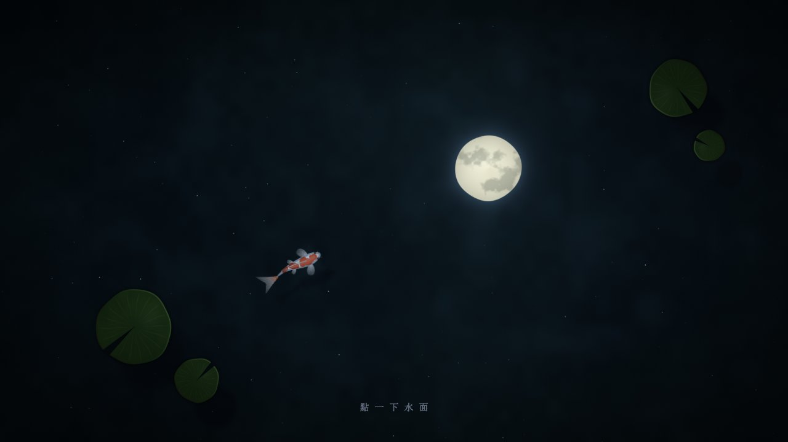
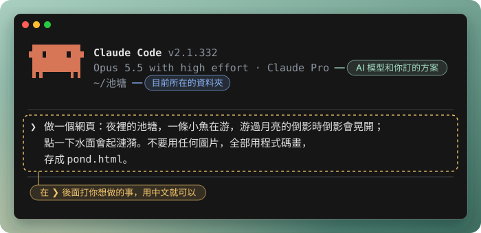
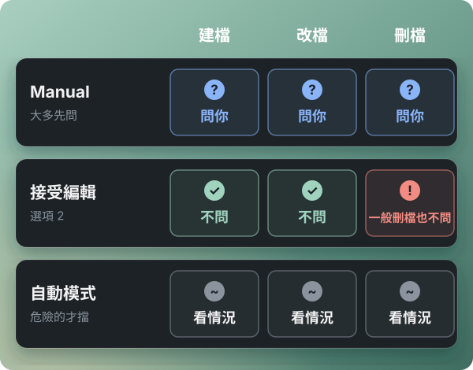
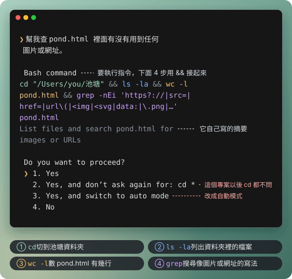

**CLI（command-line interface，命令列介面）是用打字下命令來操作電腦的方式**。你在終端機（Terminal，Mac 和 Windows 都內建的打字視窗）打一行字、按 Enter，電腦就照著做。平常用手機和電腦時，看圖示、點按鈕的那一種叫圖形介面（GUI）。

- 按鈕只有工程師事先做好的那幾顆；打字可以交代電腦做得到的幾乎任何事。
- 終端機只認特定的指令。打錯一個字母，它就說找不到指令；刪掉的檔案也不會進垃圾桶，所以以前會用的多半是工程師。
- Claude Code 是在終端機裡工作的 AI 助手。你用中文說要什麼，它替你打指令、寫程式，做好的檔案直接存進你的資料夾。



上面這座池塘是一個網頁。魚、月亮和睡蓮葉都是程式畫的，裡面沒有一張圖片。我沒寫程式，只在終端機裡打了一句話。下面用這個例子說明 CLI 是什麼、Claude Code 怎麼用，還有它要動你的檔案時，你要看懂哪一行。

## 那一句話長什麼樣？

2026 年 9 月 19 日，我在 Mac 的終端機裡用 Claude Code 打了這一句：

```
做一個網頁：夜裡的池塘，一條小魚在游，
游過月亮的倒影時倒影會晃開；點一下水面會起漣漪。
不要用任何圖片，全部用程式碼畫，存成 pond.html。
```

按下 Enter 之後，我就沒再碰鍵盤。19 分鐘後，資料夾裡多了一個叫 `pond.html` 的檔案，點開就是池塘。這 19 分鐘裡，Claude Code 自己來回跑了 28 輪：做一步，看一眼結果，再決定下一步。最後它寫了 476 行程式。

這三個數字都是第一版的。後來我請它把魚改成紅白錦鯉、把睡蓮葉調亮，上面那張圖是改好的樣子。這次用的模型是 Claude Opus 5，照 API 按用量付費的價格換算，約 5.16 美元。

## CLI 和按按鈕差在哪？

手機和電腦上的按鈕、圖示，都屬於圖形介面（GUI，graphical user interface）。終端機不一樣，視窗裡全是字，一顆按鈕也沒有。你要電腦做什麼，就打一行字，這種用法就是 CLI。

同一件事，兩種方式都做得到。例如建一個叫「練習」的資料夾：

- 按按鈕：在桌面按右鍵，選「新增檔案夾」，再打上「練習」。
- 打字：在終端機先打 `cd Desktop`，按 Enter，切到桌面；再打 `mkdir 練習`，按 Enter。資料夾會建在終端機目前所在的位置。


兩邊做完，都會多一個「練習」資料夾。`mkdir` 成功時什麼都不會印出來；如果同名的資料夾已經存在，它會回 `File exists`。

既然按按鈕就做得到，為什麼還要打字？因為按鈕只有工程師事先做好的那幾顆。手機相簿會照日期排照片，是因為工程師先想到了；沒人想到的事，就不會有那顆按鈕。打字沒有這個限制，電腦做得到的事，幾乎都能用打字交代。

## 打字這麼自由，為什麼以前很少人用？

因為終端機只認特定的字，這些字叫指令（command）。它會把你打的第一段字（到第一個空格為止）當成指令名稱。指令名稱拼錯一個字母，或直接打一句中文，它都會說找不到這個指令：


回覆開頭的 zsh，是 Mac 終端機裡負責接收指令的程式。整句中文中間沒有空格，所以它把整句當成指令名稱，結果找不到。前面的 `mkdir 練習` 能用，是因為指令名稱是 `mkdir`，「練習」只是資料夾的名字。

刪除檔案的指令是 `rm`，它也不會先跟你確認。手機刪掉的照片會先放進「最近刪除」，過一陣子才真的消失；用 `rm` 刪掉的檔案不經過垃圾桶，直接就沒了。指令要背，打字還不能出錯，所以以前會用終端機的，多半是工程師。

## 不會背指令，怎麼用終端機？

這兩年多了一個辦法：讓 AI 替你打。Claude Code 是 Anthropic 做的 AI 助手，在終端機裡工作，聽得懂中文。你說想要什麼，它會自己決定要打哪些指令、寫哪些程式。

裝好 Claude Code 之後（安裝步驟在文末「自己試一次」），在終端機打 `claude` 再按 Enter。第一次會先請你登入，登入後會看到類似這樣的畫面。終端機原本的 `%` 後面要打指令；進到 Claude Code 之後，`❯` 後面打的是你想做的事，用中文就可以：



資料夾前面的 `~` 代表你的個人資料夾，桌面、文件、下載都在裡面。

你可能用過 Claude 或 ChatGPT 的聊天 App。在那裡說同一句話，它也寫得出池塘。差別在於做好之後，東西放在哪裡：

- 聊天 App：如果它只在對話裡給你一段程式碼，你就要自己複製、自己存成檔案；想改一點，改好的版本也要再複製、再存一次。
- Claude Code：它直接把檔案存進你電腦的資料夾。要改的時候，它直接改那個檔案。

所以 Claude Code 碰得到你電腦裡的檔案：讀得到、寫得進，也刪得掉。這是它好用的原因，也是你要注意的地方。

## Claude Code 要動你的檔案前，會先問你嗎？

可以設定成先問。Claude Code 有一種權限模式叫 Manual（手動模式）。在這個模式下，它要建檔、改檔，或執行大部分指令之前，都會停下來問你；只是讀資料夾裡的檔案，通常不問。

假如它要建立 `pond.html`，會跳出下面這樣的畫面。這個畫面是我另外請它建立測試檔時跳出來的，檔名和內容換成了 `pond.html`：


你要看懂的只有一件事：它要做什麼。第 2 個選項要小心，選了之後，在這個資料夾裡，連一般的刪檔都不會再問你。

做池塘那次，它一次也沒問我。因為我用的是不開對話畫面的方式（`claude -p`，下指令時就把整個任務交給它），而且開工前只准它存檔。我敢這樣做，是因為那是剛建好的空資料夾，裡面沒有怕被弄壞的東西。平常的資料夾，我每次都會看。



另外要知道：Claude Code 2.1.283 版以後，在終端機打開時預設是自動模式（auto mode），前提是你用的模型支援它，而且公司帳號的管理員沒有關掉它。這個模式改由另一個 AI 模型替你審查動作：看起來安全的直接做，看起來危險的先擋下來。想要它改東西、執行指令前都先問你，就用下面「自己試一次」裡的 `--permission-mode manual`。

## 它說做好了，就真的好了嗎？

池塘寫完時，Claude Code 回我：「我寫好 pond.html 了，但還沒實際跑過。這個環境不准開瀏覽器或執行腳本，所以只做了逐行人工檢查。」它寫了 476 行，卻一次也沒看過畫面，因為我只准它存檔，沒准它開瀏覽器或執行程式。

所以我自己查了兩次。第一次，我直接點開檔案：魚在游，點水面會起漣漪。第二次，我用中文請它查有沒有用到圖片。它要執行一行指令，先停下來問我：



四個步驟都只是看和找，沒有改檔或刪檔，所以我按了 1。如果有哪一步看不懂，就先選 No 拒絕，請它一段一段解釋，再決定要不要讓它做。

新版的 Claude Code 會直接執行這類只看不改的指令，不再跳出這個詢問；差異寫在文末。

它回我：「沒有。pond.html 沒用到任何圖片檔，也沒有任何網址。」這次搜尋沒找到圖片檔或網址。

## 自己試一次

**打開終端機**：這一步免費，也不會改到電腦裡的東西。

- Mac：按住 ⌘ Command 再按空白鍵，打「終端機」，按 Enter。視窗出來後打 `cal`，按 Enter，它會印出這個月的月曆。
- Windows：按開始，搜尋「PowerShell」（Windows 的終端機）並打開。打 `Get-Date`，按 Enter，它會顯示現在的日期和時間。

**安裝 Claude Code**：安裝指令本身不用帳號，但登入使用要有 Claude 的付費方案（Pro 以上）或 Anthropic Console 帳號，免費方案不能用。電腦要是 macOS 13 以上，或 Windows 10（1809 版）以上。安裝指令會在電腦上裝東西，所以只貼[官方安裝頁](https://code.claude.com/docs/en/setup)上的那一行。

Mac：

```
curl -fsSL https://claude.ai/install.sh | bash
```

Windows（PowerShell）：

```
irm https://claude.ai/install.ps1 | iex
```

裝好之後，把終端機視窗關掉，再開一個新的。不重開的話，打 `claude` 可能會顯示找不到指令。

**在空資料夾裡打開 Claude Code**：空資料夾弄亂了也沒關係。每行打完按一次 Enter：

```
mkdir 第一次練習
cd 第一次練習
claude --permission-mode manual
```

第一行建一個叫「第一次練習」的資料夾，第二行進到這個資料夾，第三行打開 Claude Code，並設定成改東西、執行指令前都先問你。如果第一行顯示 `File exists`，代表已經有同名的資料夾，換個名字再打一次這三行。第一次打開時，它會開瀏覽器請你登入，也會問你信不信任這個資料夾；這是你剛建的空資料夾，選信任就好。要離開時打 `/exit`。

**從一件小事開始**：把 3 月 14 日換成你的生日，打這句話：

```
做一張網頁，倒數到我的生日（3 月 14 日），存成 birthday.html。
```

它說做好了，就請它幫你打開。它要執行打開檔案的指令時會先問你，看得懂那是「打開」就選 Yes。打開之後，自己算一下天數對不對。我在 2026 年 10 月 2 日照這句話做過一次。它做完自己說「沒能驗證日期邏輯」，所以我自己算了一次天數，它算對了。

## 這篇的畫面怎麼來的

- 池塘是 2026 年 9 月 19 日在 macOS 上用 Claude Code 的非互動模式 `claude -p` 做出來的，所以當時沒有經過「先問你」的畫面。生日網頁是 2026 年 10 月 2 日用同樣方式做的。
- 三個 Claude Code 畫面照 2.1.277 版的真實畫面抄寫，再畫成圖；圖上的彩色標註是我加的。抄寫時，資料夾名稱和路徑換過，太長的行照終端機的樣子換行，中間省略了幾行。建立檔案那個畫面，是我請它建立測試檔時真的跳出來的（我按了 No），檔名和內容換成 `pond.html` 的前三行，「後面還有 473 行」是我補的。
- 2026-11-24 對照 2.1.330 版的官方文件，畫面有幾處不同：Pro 方案的預設模型改成 Opus 5.5；執行指令的詢問框改用虛線框出指令；`cd`、`ls`、`wc`、`grep` 這類只看不改的指令，現在任何模式下都直接執行，所以照文中那句請它查圖片，通常不會跳出詢問。
- `zsh: command not found` 和 `mkdir` 在 Mac 上實際跑過；Windows 的步驟沒有在 Windows 電腦上跑過。
- 安裝指令、方案需求和權限模式的說明，2026-11-24 對照過官方文件。

## 資料來源

- [Set up Claude Code](https://code.claude.com/docs/en/setup)
- [Choose a permission mode](https://code.claude.com/docs/en/permission-modes)
